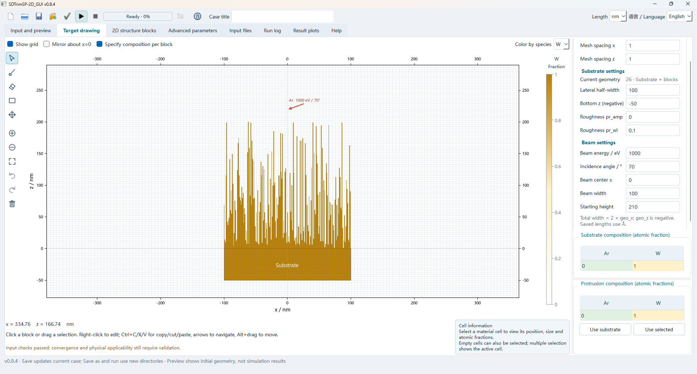
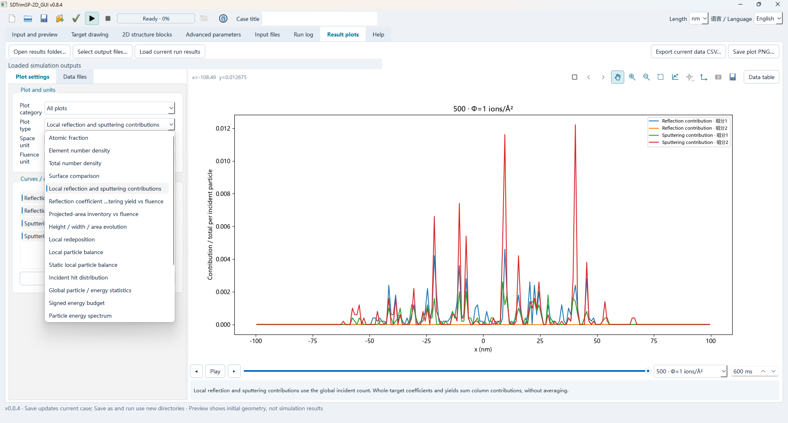
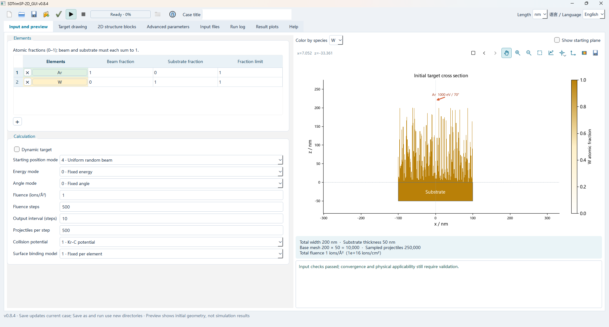

# SDTrimSP-2D GUI

A desktop GUI for preparing SDTrimSP-2D input cases, editing 2D target structures, and inspecting simulation outputs.

> This repository contains the GUI only. It does not include the SDTrimSP-2D engine, material tables, sample cases, simulation outputs, or the official manual. A compatible engine and its required data must be obtained and installed separately. Without an engine, the GUI can still be opened for editing and inspecting existing files, but it cannot run calculations.

## Features

- Create, edit, validate, and save input cases.
- Draw and edit target structures with grid-based selection and composition controls.
- Preview target geometry and beam settings.
- Load and inspect available simulation output files with interactive plots and data export.
- English and Chinese interface.
- Optional external engine configuration. The engine path is stored in the user's local application settings.

## Screenshots

### Target editor



### Result plots



### Input and preview



## Requirements

- Windows 10 or 11
- Python 3.11+
- Dependencies listed in `requirements.txt`
- For calculations: a compatible SDTrimSP-2D engine, its material tables, and the runtime environment required by that engine

The engine is not bundled or redistributed here. Please obtain it directly from its authors or an authorized source and follow its own license and installation instructions.

## Run from source

```powershell
python -m venv .venv
.venv\Scripts\Activate.ps1
python -m pip install -r requirements.txt
python app.py
```

Use **Engine settings** to select the external engine root directory. The selected installation must provide a compatible run script and material table. If no engine is configured, editing remains available and calculation is disabled.

## Third-party notices

See `PLOTTER-LICENSE.txt` for the license notice applicable to the included plotting component.
